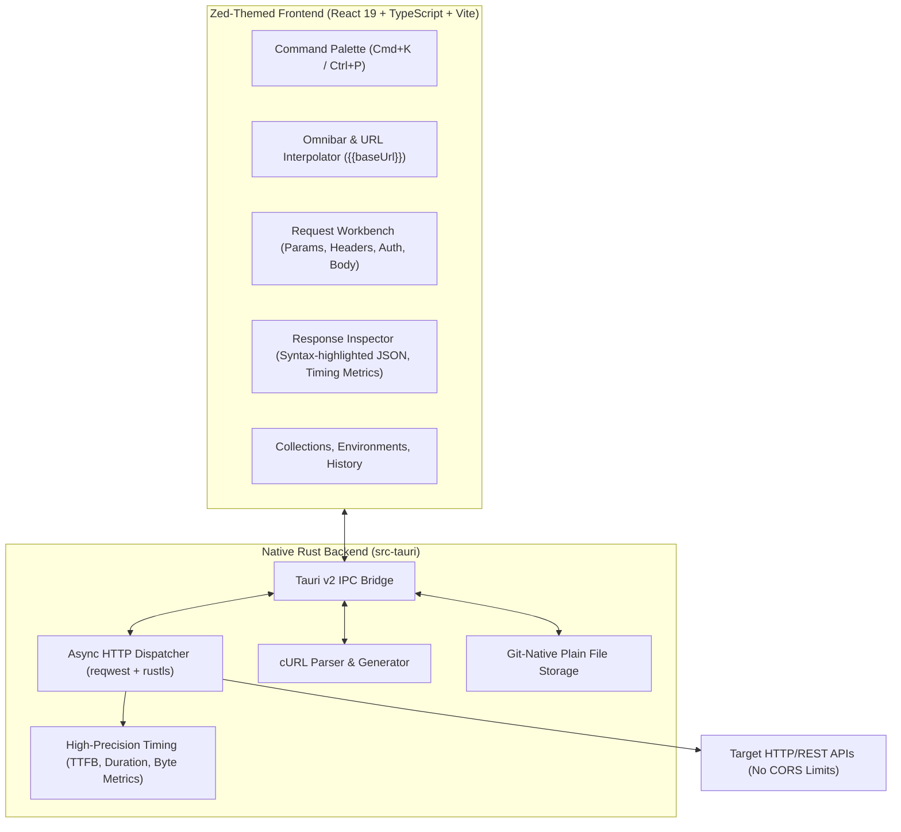

# Reqcraft ⚡

<p align="center">
  
</p>

<p align="center">
  <b>A lightweight, blazing-fast Postman alternative crafted in Rust with a Zed-inspired minimalist UI.</b>
</p>

<p align="center">
  <a href="https://github.com/Kavin-Nithil/Reqcraft/releases"></a>
  
  
  
  
</p>

---

## 🌟 Why Reqcraft?

Postman and Insomnia have evolved into heavy, cloud-mandatory enterprise suites consuming 800MB+ of RAM. **Reqcraft** brings back the joy of an ultra-fast, local-first API workbench:

- ⚡ **Blazing Fast Native Core**: Powered by **Rust** and `reqwest` + `tokio`. Instant startup, microsecond response timings, zero memory bloat (~35 MB RAM).
- 🎨 **Zed Editor Aesthetic**: High-density charcoal dark UI with clean typography, hairline borders, and color-coded HTTP method badges.
- 📁 **100% Git-Friendly**: No proprietary cloud sync or required logins. Collections and environments are plain JSON files stored in your workspace, making them trivially version-controllable with `git`.
- ⌨️ **Keyboard-First Ergonomics**: Command Palette (`⌘K` / `Ctrl+P`) for rapid switching between collections and history, `Ctrl+Enter` to dispatch requests.
- 🔄 **cURL & Postman Compatibility**: One-click import from cURL commands and Postman v2.1 collections. Instant copy-as-cURL for quick terminal debugging.
- 📦 **Automated Cross-Platform Releases**: GitHub Actions builds native installers (`.deb`, `.AppImage`, `.dmg`, `.msi`, `.exe`) on every tag release.

---

## 📐 Architecture

Reqcraft combines the security and speed of a compiled Rust backend with the reactive fluidity of a modern TypeScript frontend:



---

## 🚀 Getting Started

### Prerequisites

- [Rust](https://www.rust-lang.org/tools/install) (1.78+)
- [Node.js](https://nodejs.org/) (20+) & [pnpm](https://pnpm.io/) (9+)
- On Linux (Ubuntu/Debian):
  ```bash
  sudo apt install -y libwebkit2gtk-4.1-dev libappindicator3-dev librsvg2-dev patchelf
  ```

### Development Setup

1. **Clone the repository:**
   ```bash
   git clone https://github.com/Kavin-Nithil/Reqcraft.git
   cd Reqcraft
   ```

2. **Install frontend dependencies:**
   ```bash
   pnpm install
   ```

3. **Run in development mode:**
   - **Desktop App (Tauri + Rust core):**
     ```bash
     pnpm tauri dev
     ```
   - **Browser Preview (Fast UI prototyping):**
     ```bash
     pnpm dev
     ```

---

## 📦 Packaging & GitHub Releases

Reqcraft is configured with automated multi-platform builds using GitHub Actions.

To produce a new release with installers for **macOS (.dmg)**, **Linux (.deb, .AppImage)**, and **Windows (.msi, .exe)**:

1. Update the version number in `package.json` and `src-tauri/Cargo.toml`.
2. Commit the changes, tag the release, and push:
   ```bash
   git tag v0.1.0
   git push origin v0.1.0
   ```
3. GitHub Actions will automatically compile all binaries in parallel and attach the installers to a draft release on GitHub!

---

## ⌨️ Keyboard Shortcuts

| Shortcut | Action |
| :--- | :--- |
| `Ctrl+Enter` / `⌘Enter` | Send active HTTP request |
| `Ctrl+K` / `⌘K` or `Ctrl+P` | Open Command Palette / Quick switcher |
| `Ctrl+B` | Toggle Collections sidebar |
| `Esc` | Dismiss modals and command palette |

---

## 🛡️ License

Reqcraft is open-source software licensed under the [MIT License](LICENSE).
